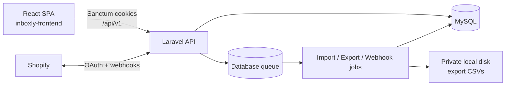

# Inboxly Backend

Laravel REST API for **Inboxly**, a workspace-based Shopify marketing SaaS.

This repository owns authentication, tenancy (workspaces and stores), Shopify connection lifecycle, and the Audience domain (contacts, consents, tags, segments, imports, exports). Campaigns, automations, and message sending are **not** implemented here yet.

**Frontend (separate repository):** [inboxly-frontend](https://github.com/rehansaeedoveelabs/inboxly-frontend)

## Responsibilities

- Session-based SPA authentication via Laravel Sanctum
- Workspace membership and Admin / Marketer authorization
- Store creation, activation, and Shopify OAuth / webhooks / disconnect
- Store-scoped contacts, tags, consents, restore + consent review
- Rules-only audience segments with live preview
- Background contact import and export jobs
- Private CSV export storage and authorized download

## Technology stack

| Component | Version / notes |
|-----------|-----------------|
| PHP | `^8.2` (`composer.json`); local docs target 8.4+ extensions |
| Laravel | `^12` |
| Sanctum | `^4.3` (cookie SPA auth, not API tokens for the SPA) |
| Database | MySQL 8+ (`inboxly` app DB; `inboxly_testing` for PHPUnit) |
| Queue | Database driver (`jobs` / `failed_jobs`) |
| API prefix | `/api/v1` (`bootstrap/app.php`) |

## Implemented capabilities (current)

- Auth: register, login, logout, profile, password change, password reset, email verification links
- Workspaces: create, list, show, update; member list; invitation **create** (accept flow not implemented)
- Stores: create (real or demo), list, activate; soft-delete hooks exist (no HTTP delete/update routes)
- Shopify: OAuth start/callback, reconnect, disconnect, uninstall + scopes webhooks, webhook registration job
- Audience: contacts CRUD, tags, consents + events, soft-delete restore, consent-review gate
- Segments: CRUD + preview (rules evaluated at query time)
- Imports: JSON row payload → queued job (no multipart file upload)
- Exports: queued CSV generation, history, secure download, daily prune

See [docs/ROADMAP-AND-GAPS.md](docs/ROADMAP-AND-GAPS.md) for incomplete and planned work.

## High-level architecture



More detail: [docs/ARCHITECTURE.md](docs/ARCHITECTURE.md)

## Authentication and tenancy

- SPA calls `GET /sanctum/csrf-cookie`, then mutates with `X-XSRF-TOKEN` and `credentials: 'include'`.
- Do **not** store API tokens in `localStorage` for the first-party SPA.
- Tenant boundary: **User → Workspace → Store → Audience data**.
- Roles: `Admin` (workspace/stores/Shopify) and `Marketer` (audience). Enforced via policies and FormRequests.

Details: [docs/SECURITY.md](docs/SECURITY.md), [docs/APPLICATION-FLOWS.md](docs/APPLICATION-FLOWS.md)

## Local setup

```bash
cp .env.example .env
composer install
php artisan key:generate
```

Create dedicated MySQL databases (never point this app at unrelated shared databases):

```sql
CREATE DATABASE inboxly CHARACTER SET utf8mb4 COLLATE utf8mb4_unicode_ci;
CREATE DATABASE inboxly_testing CHARACTER SET utf8mb4 COLLATE utf8mb4_unicode_ci;
```

Configure `.env` from `.env.example` (never commit `.env`):

- `DB_*` → database `inboxly`
- `FRONTEND_URL`, `SANCTUM_STATEFUL_DOMAINS`, `CORS_ALLOWED_ORIGINS` → match the SPA origin
- Shopify keys only when testing OAuth (`SHOPIFY_*`)

```bash
php artisan migrate
php artisan serve
```

- API: `http://localhost:8000`
- Health: `GET /up`

Do **not** run `migrate:fresh` / `db:wipe` against shared or production data.

## Queues and scheduler

Imports, exports, and Shopify webhook registration require a worker:

```bash
php artisan queue:work
```

Scheduled commands (`bootstrap/app.php`):

- Hourly: `shopify:prune-oauth-states`
- Daily: `contact-exports:prune`

Locally, run the scheduler when testing those paths:

```bash
php artisan schedule:work
```

`DB_QUEUE_RETRY_AFTER` defaults to **360** seconds so it exceeds the export job timeout (**300**). See `.env.example` and `config/queue.php`.

## Tests

PHPUnit is forced to `inboxly_testing` in `phpunit.xml` (`force="true"`).

```bash
php artisan test
```

## Useful commands

```bash
php artisan about
php artisan route:list --path=api/v1
php artisan migrate:status
php artisan config:clear
```

## Documentation

| Document | Contents |
|----------|----------|
| [docs/ARCHITECTURE.md](docs/ARCHITECTURE.md) | Layers, Shopify, queues, diagrams |
| [docs/DATABASE.md](docs/DATABASE.md) | Tables, constraints, ER diagram |
| [docs/APPLICATION-FLOWS.md](docs/APPLICATION-FLOWS.md) | End-to-end request flows |
| [docs/SECURITY.md](docs/SECURITY.md) | AuthZ, isolation, encryption, gaps |
| [docs/ROADMAP-AND-GAPS.md](docs/ROADMAP-AND-GAPS.md) | Implemented vs incomplete vs planned |

## Production checklist (deployment-dependent)

- `APP_ENV=production`, `APP_DEBUG=false`, unique `APP_KEY`
- Real `APP_URL`, `FRONTEND_URL`, Sanctum stateful domains, CORS origins
- `SESSION_SECURE_COOKIE=true` behind HTTPS
- SMTP, queue worker, and cron/`schedule:run`
- Never commit `.env` or credentials
