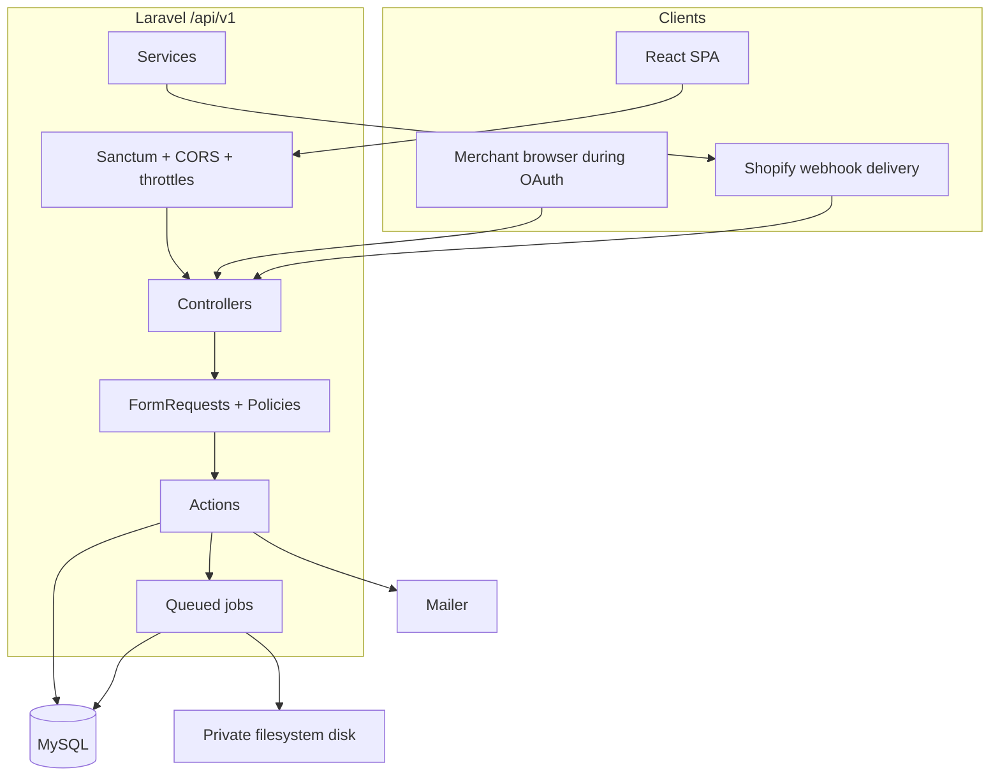
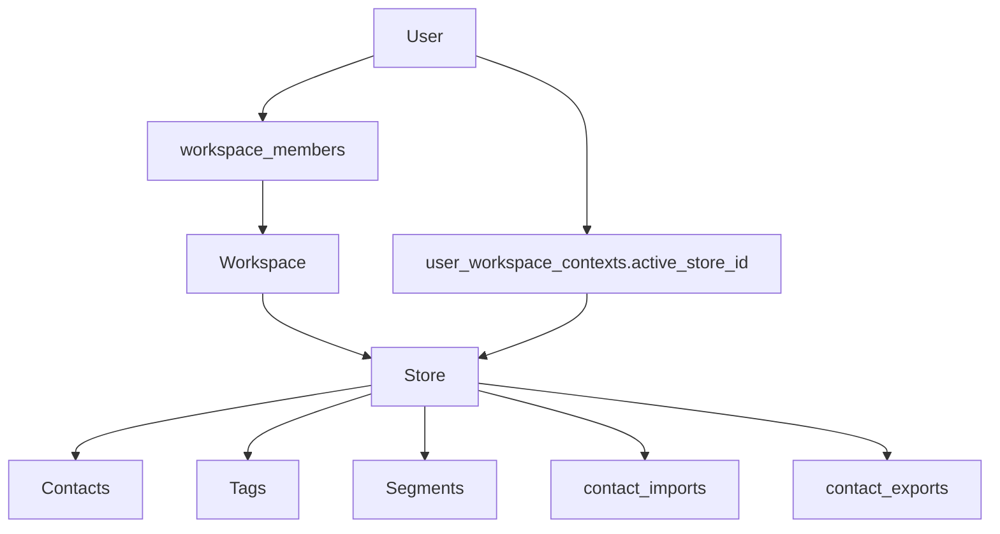
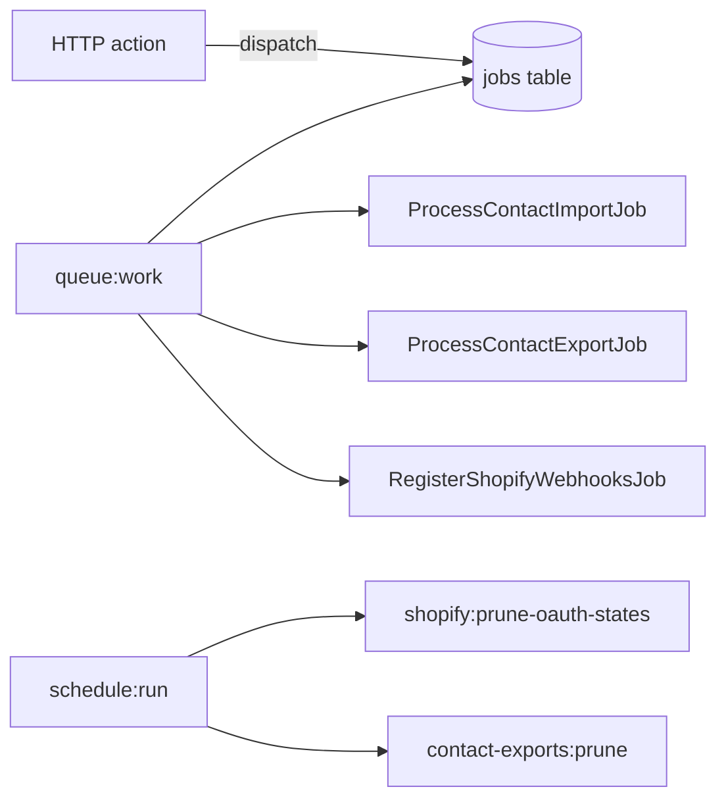

# Backend architecture

Companion to the [README](../README.md). Describes how the Laravel API is structured today.

## System context

Inboxly splits into two repositories:

| Repository | Role |
|------------|------|
| `inboxly-backend` | REST API, domain logic, jobs, MySQL, private files |
| `inboxly-frontend` | React SPA (Sanctum cookie client) |

There is no server-rendered app shell in this repo (`routes/web.php` is the default welcome view only).

## Backend layers

| Layer | Location | Responsibility |
|-------|----------|----------------|
| Routes | `routes/api.php` | HTTP surface under `/api/v1` |
| Controllers | `app/Http/Controllers/Api/V1/**` | Thin HTTP adapters |
| Form requests | `app/Http/Requests/**` | Validation + often `authorize()` |
| Policies | `app/Policies/**` | Workspace/store membership gates |
| Actions | `app/Actions/**` | Single-purpose use cases |
| Support | `app/Support/**` | Shared query/rules helpers (e.g. `ContactListQuery`, `SegmentQueryBuilder`) |
| Services | `app/Services/Shopify/**` | Shopify HTTP clients and credential helpers |
| Jobs | `app/Jobs/**` | Async import, export, webhook registration |
| Models | `app/Models/**` | Eloquent + domain helpers |
| Commands | `app/Console/Commands/**` | Prune OAuth states; prune exports |
| Resources | `app/Http/Resources/**` | JSON shaping (hide secrets/paths) |

Laravel auto-discovers policies by model naming (no explicit `Gate::policy` map in `AppServiceProvider`).

## Frontend ↔ backend communication

1. Browser loads the SPA (Vite in development).
2. SPA calls `GET /sanctum/csrf-cookie` (see Sanctum), then API routes with session cookie + `X-XSRF-TOKEN`.
3. Dev proxy: frontend Vite forwards `/api` and `/sanctum` to the Laravel host (frontend repo `vite.config.js`).
4. CORS allows exact SPA origins from `CORS_ALLOWED_ORIGINS` / `FRONTEND_URL` (`config/cors.php`) with credentials.

Redirects after Shopify OAuth and email verification are built from `config('app.frontend_url')` via `App\Support\FrontendUrl` — never from untrusted Host headers.

## Tenancy model

Authorization always resolves **store → workspace → membership** (for example `ContactPolicy` → `StorePolicy::manageAudience`).

Roles (`App\Enums\WorkspaceRole`):

- **Admin** — workspace settings, invites, create stores, Shopify connect/disconnect
- **Marketer** — audience management (contacts, tags, segments, imports, exports)

## Shopify integration architecture

Primary code:

- `App\Actions\Shopify\StartShopifyOAuth`
- `App\Actions\Shopify\HandleShopifyOAuthCallback`
- `App\Actions\Shopify\DisconnectShopifyStore`
- `App\Actions\Shopify\HandleShopifyWebhook`
- `App\Services\Shopify\ShopifyOAuthClient`
- `App\Services\Shopify\ShopifyCredentialService` (**implemented; not wired into request paths today**)
- `App\Jobs\RegisterShopifyWebhooksJob`

Flow summary:

1. Admin starts OAuth on a non-demo store with a persisted `*.myshopify.com` domain.
2. Server stores single-use `ShopifyOauthState` and redirects to Shopify.
3. Callback verifies HMAC + state, exchanges code, verifies shop identity, encrypts tokens on `stores`.
4. Best-effort webhook registration for `APP_UNINSTALLED` and `APP_SCOPES_UPDATE`.
5. Uninstall webhook clears credentials; disconnect clears credentials (remote revoke best-effort).

**Not implemented:** Shopify customer/order/product sync. Connection is for app install lifecycle, not catalog import.

## Queue and schedule architecture

| Job / command | Source | Notes |
|---------------|--------|-------|
| `ProcessContactImportJob` | `StartContactImport` | `tries = 1`; clears `options.rows` on success |
| `ProcessContactExportJob` | `StartContactExport` | `timeout = 300`; atomic status claims; private CSV |
| `RegisterShopifyWebhooksJob` | OAuth success | Retries with backoff |
| `shopify:prune-oauth-states` | Hourly schedule | Expired / old consumed states |
| `contact-exports:prune` | Daily schedule | Stale `processing` → failed; expired files/rows |

Database queue `retry_after` defaults to **360** (`config/queue.php`, `DB_QUEUE_RETRY_AFTER`) so it exceeds the export timeout.

### Meta publishing timeouts (operators)

| Knob | Default | Rule |
|------|---------|------|
| `ProcessMetaPublicationJob::$timeout` | 120s | Job wall clock |
| `META_TIMEOUT_SECONDS` | 20s | Per Graph HTTP call |
| `META_PUBLISH_LEASE_SECONDS` | 180s | Must exceed job timeout |
| Queue worker `--timeout` | (operator) | Must be ≥ job timeout; keep `META_PUBLISH_LEASE_SECONDS` above worker timeout |

Do not lower the lease below the job timeout. Atomic lease claims and lease-token ownership are unchanged.

### Meta token health limitations

- `data_access_expires_at` is persisted only when Meta `GET /debug_token` returns a positive unix timestamp. Zero or omitted values stay `null` (not treated as expired).
- Inspection requires configured `META_APP_ID` + `META_APP_SECRET` (app access token). If inspection is unavailable, Inboxly does not invent expiry or invalidate the connection.
- There is no proactive scheduled token monitor; expiry is enforced at OAuth persist, publish create, and Page-token preflight.

## Related docs

- [DATABASE.md](DATABASE.md)
- [APPLICATION-FLOWS.md](APPLICATION-FLOWS.md)
- [SECURITY.md](SECURITY.md)
- [ROADMAP-AND-GAPS.md](ROADMAP-AND-GAPS.md)
