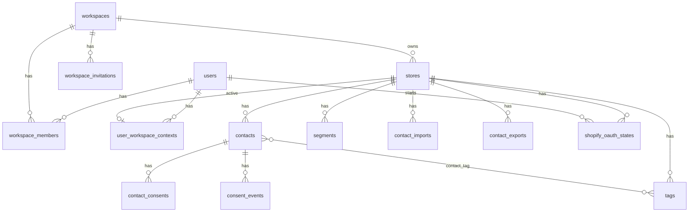

# Database architecture

Primary schema lives under `database/migrations/`. All application primary keys use **ULIDs**.

## Tenant boundary

Audience and Shopify connection data hang off **stores**, which belong to **workspaces**. Cross-workspace access is denied in application policies even if a ULID is guessed.

```text
users
  └── workspace_members (role: admin|marketer)
        └── workspaces
              └── stores
                    ├── contacts → consents / consent_events / tags
                    ├── tags
                    ├── segments
                    ├── contact_imports
                    └── contact_exports
```

Per-user store selection: `user_workspace_contexts (user_id, workspace_id) → active_store_id`.

## Main tables

| Table | Purpose | Soft deletes |
|-------|---------|--------------|
| `users` | Accounts | No |
| `workspaces` | Tenant org | Yes |
| `workspace_members` | Membership + role | No |
| `workspace_invitations` | Pending invites (hashed token) | No |
| `user_workspace_contexts` | Active store per user/workspace | No |
| `stores` | Shop / demo store + Shopify credentials | Yes |
| `contacts` | Audience people | Yes |
| `contact_consents` | Current status per channel | No |
| `consent_events` | Append-only audit of consent changes | No (`updated_at` absent) |
| `tags` / `contact_tag` | Labels | Tag hard-delete |
| `segments` | Named rule sets (JSON) | Yes |
| `contact_imports` | Import jobs + counters | No |
| `contact_exports` | Export jobs + file metadata | No |
| `shopify_oauth_states` | One-time OAuth CSRF/state | No |
| `shopify_webhook_deliveries` | Webhook idempotency | No |
| `sessions`, `jobs`, `failed_jobs`, `cache`, … | Framework | — |

## Relationships (ER)



## Important constraints and indexes

### Contacts (`2026_11_10_160000_create_contacts_table.php`)

- Unique `(store_id, email)`, `(store_id, phone)` — empty values stored as `NULL` so multiple nulls are allowed
- Index `(store_id, created_at, id)` for keyset / cursor pagination
- Soft deletes; uniqueness includes soft-deleted rows (restore / conflict behavior)

### Consents

- `contact_consents`: unique `(contact_id, channel)` for `email` | `sms` | `push`
- `consent_events`: append-only in the model (`ConsentEvent` rejects update/delete)
- `contacts.consent_review_required_at` added in `2026_11_11_190000_*` for restore review gate

### Tags / segments

- `tags`: unique `(store_id, slug)` — segment rules reference slugs; updates keep slug stable
- `segments.rules`: JSON; membership is **not** materialized

### Stores / Shopify

- Encrypted `shopify_access_token`, `shopify_refresh_token` (Eloquent `encrypted` cast)
- Global uniqueness on Shopify shop identity columns (see stores Shopify migrations)
- Soft delete clears Shopify identity/credentials so the shop can reconnect elsewhere (`Store::booted`)

### Imports / exports

- `contact_imports.options` may hold temporary `rows` until success (then cleared by the job)
- `contact_imports.restored_count` tracks soft-delete restores during import
- `contact_exports`:
  - `status`: pending | processing | completed | failed
  - `filters` JSON (list-compatible filters)
  - `disk`, `path` (private relative path; not API-exposed)
  - `expires_at`, `started_at`, `finished_at`
  - Indexes on `(store_id, created_at)` and `expires_at`

### Shopify supporting tables

- `shopify_oauth_states`: unique `state`; prune indexes for expiry/consumed cleanup
- `shopify_webhook_deliveries`: unique `webhook_id` for replay protection
- `shopify_compliance_requests`: durable privacy webhook work; `processing_lease_expires_at` / `processing_lease_token` for crash-safe reclaim; append-only `shopify_compliance_request_events` (`restrictOnDelete` on parent). Ops: [M1-COMPLIANCE-OPERATIONS.md](M1-COMPLIANCE-OPERATIONS.md).

## Foreign-key behavior (summary)

- Deleting a **store** hard-cascades to contacts, tags, segments, imports, exports, OAuth states (soft delete does **not** fire those cascades)
- `workspaces.owner_id` → `restrictOnDelete`
- `user_workspace_contexts.active_store_id` → `nullOnDelete`

## Export storage metadata vs files

Database rows describe status and optional `path` on the **private** `local` disk (`storage/app/private`). Files are not publicly URL-routed. Download goes through `ContactExportController@download` after policy + status/expiry/existence checks.

## Related docs

- [ARCHITECTURE.md](ARCHITECTURE.md)
- [APPLICATION-FLOWS.md](APPLICATION-FLOWS.md)
- [SECURITY.md](SECURITY.md)
